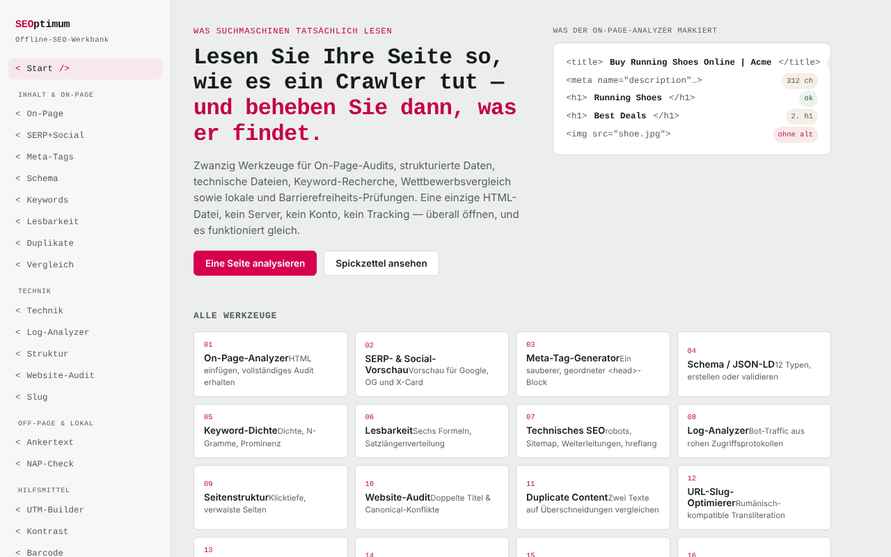

# SEOptimum

[English](README.md) · [Română](README.ro.md) · [Français](README.fr.md) · [Italiano](README.it.md) · [Español](README.es.md) · [Português](README.pt.md) · **Deutsch** · [Magyar](README.hu.md)

**Version:** 2.1.0 · **Zuletzt aktualisiert:** 2026-10-27

Oberflächensprachen: **Română, English, Français, Italiano, Español, Português (PT), Deutsch, Magyar**

SEO-Werkstatt in einer einzigen HTML-Datei: zwanzig Werkzeuge, die im Browser laufen.

**Live-App:** https://chiuta.github.io/SEOptimum/

## Was es ist

SEOptimum („offline SEO workbench“) vereint Werkzeuge für On-Page-Audits, strukturierte Daten, technische Dateien, Content, Off-Page- und lokales SEO. Die Analyse erfolgt im Browser-Tab, am Text oder HTML, das du einfügst; die App hat weder Konten noch Analytics. Die Oberfläche ist auf Englisch und Rumänisch verfügbar (Schaltflächen „EN“ / „RO“).

## Funktionen

Das Menü enthält 20 Werkzeuge, wie folgt gruppiert:

- **Content & on-page:** On-Page-Analysator (Titel, Überschriften, Bilder, Links, Meta, strukturierte Daten, Ziel-Keyword), SERP- und Social-Vorschau (Google Desktop/Mobil, Facebook/LinkedIn, X/Twitter), Meta-Tag-Generator, Schema / JSON-LD (Erstellung und Validierung, Rich-Result-Vorschau), Keyword-Recherche (Dichte und N-Gramme, Clustering, Intention und Long-Tail, Kannibalisierung), Lesbarkeit (sechs Formeln, Prüfung auf Featured Snippet), Prüfer für doppelte Inhalte, Wettbewerbervergleich.
- **Technical:** technische Dateien (robots.txt, sitemap.xml, Weiterleitungen, hreflang, llms.txt und weitere in der App erzeugte Dateien), Log-Analysator, interne Struktur und Klicktiefe, Website-Audit, Slug-Optimierer.
- **Off-page & local:** Ankertext-Analysator, NAP-Konsistenzprüfer.
- **Utilities:** UTM-Builder, WCAG-2.2-Kontrastprüfer, GTIN-/Barcode-Validator (UPC-A, EAN-8, EAN-13, GTIN-14).
- **Reference:** SEO-Checkliste (Markdown-Export) und Referenzblatt.
- **Schnelle Prüfung strukturierter Daten:** Im On-Page-Analysator hat jeder gefundene JSON-LD-Block die Schaltfläche „Pflichtfelder im Schema-Werkzeug prüfen →“, die ihn an den Tab Validate schickt und die Validierung ausführt.
- **Tastenkürzel:** `Strg/Cmd+Eingabe` in einem Textfeld löst die nächstgelegene Hauptschaltfläche aus (Analyze, Generate, Check usw.).
- Export des On-Page-Berichts (`on-page-report.md`) und Drucken.

## Bedienungsanleitung

1. Öffne die Seite und wähle die Sprache mit „EN“ / „RO“; das Design (Theme) lässt sich in der Kopfzeile ändern.
2. Wähle im Menü links ein Werkzeug (zum Beispiel `<on-page/>`).
3. Füge im On-Page-Analysator den HTML-Quelltext der Seite (im Browser: Strg/Cmd+U, kopieren) in „Page HTML source“ ein, fülle optional „Focus keyword“ aus und klicke auf „Analyze“.
4. Optional „Page URL“ ausfüllen und „Try fetch“ drücken, um den direkten Abruf zu versuchen; die meisten Websites blockieren die Anfrage (CORS), dann benutzt du das manuelle Einfügen.
5. Mit „Export report“ lädst du den `.md`-Bericht herunter, oder nutze „Print report“.
6. Fülle in den Generatoren (Meta, Schema, UTM usw.) die Felder aus und klicke auf „Copy“.
7. Im UTM-Builder behält „Save to list“ die gespeicherten Links in diesem Browser.
8. Hake in der „SEO audit checklist“ die Punkte ab; der Zustand bleibt lokal erhalten, und der Export erzeugt `seo-checklist.md`.

## Datenschutz und Netzwerk

- **Lokale Speicherung:** `localStorage`, Schlüssel mit dem Präfix `seoFF.` (Sprache, Design, gespeicherte UTM-Liste, Zustand der Checkliste).
- **Netzwerk:** Die App sendet Anfragen nur bei ausdrücklichen Aktionen des Nutzers: der Schaltfläche „Try fetch“ (`fetch` an die von dir eingegebene URL, an eine beliebige Website) und der Vorschau eines per URL angegebenen `og:image`-Bildes (der Browser lädt das Bild von dieser URL). Die CSP der Seite erlaubt diese Verbindungen (`connect-src *`, `img-src https: http:`). Im Übrigen erfolgt die Analyse lokal; es gibt kein CDN, keine externen Schriften und keine Analytics.
- Die Domains `example.com`, `schema.org` usw. im Code erscheinen als Beispiele oder Vokabelbezeichner, nicht als geladene Ressourcen.

- **CSP:** Skripte sind nur per `sha256`-Hash erlaubt (kein `'unsafe-inline'` für Skripte); das Druckfenster des Berichts verwendet kein Inline-Skript mehr (das Drucken wird vom Haupttab aus gestartet). Inline-Stile bleiben erlaubt.

## Lokale Ausführung / offline

Lade `index.html` herunter und öffne sie im Browser; sie funktioniert ohne Internet. Nur „Try fetch“ und die Vorschau entfernter Bilder benötigen eine Verbindung.

## Lizenz

MIT für den Code und die Struktur der App — siehe Datei `LICENSE`. Eventuell in der Datei enthaltene Drittbibliotheken behalten ihre eigenen Lizenzen.

## Audit

Audit: 2026-10-10 — mit Playwright und axe-core (WCAG 2.1 AA) geprüft; Farbkontrast und horizontaler Überlauf auf schmalen Bildschirmen wurden korrigiert. Die Direktive `frame-ancestors` wurde aus dem CSP-Meta-Tag entfernt (Browser ignorieren sie in `<meta>`; sie funktioniert nur als HTTP-Header, den GitHub Pages nicht zulässt). `connect-src *` und `img-src https: http:` bleiben absichtlich weit gefasst, da „Try fetch“ und die `og:image`-Vorschau beliebige vom Nutzer eingegebene URLs laden; sie lassen sich nicht einschränken, ohne die Funktion zu zerstören.

## Autor

Alexio — Alexandru-Ionuț Chiuță, Kontakt: alexio@trom.tf

## Zusammenfassung

SEOptimum ist eine SEO-Werkstatt in einer einzigen Datei mit 20 Werkzeugen (On-Page-Analysator, SERP-/Social-Vorschau, Meta- und JSON-LD-Generatoren, Keyword-Recherche, Lesbarkeit, robots/sitemap/hreflang/llms.txt, Log-Analysator, Website-Audit, UTM-Builder, WCAG-Kontrast, GTIN-Validator, Checkliste). Oberfläche auf Englisch/Rumänisch. Die Analyse läuft lokal; das Netzwerk wird nur für die optionale Schaltfläche „Try fetch“ und für entfernte og:image-Vorschauen verwendet. Einstellungen werden in localStorage gespeichert (Schlüssel `seoFF.`).

## Am 11.10.2026 geprüfte Quellen

- Die Liste der KI-Bots im Referenzblatt (GPTBot, OAI-SearchBot, ChatGPT-User, ClaudeBot, Claude-SearchBot, Claude-User, PerplexityBot, Google-Extended usw.) wurde anhand öffentlicher Leitfäden von 2026 erneut geprüft (z. B. searchenginejournal.com/ai-crawler-user-agents-list, anagram.ai/blog/ai-crawler-user-agent-list-2026-14-bots-and-robotstxt-tokens-to-know); die Namen stimmen überein, aber das Verhalten der Bots ändert sich — die Liste bleibt in der App als vergänglich gekennzeichnet.

## Verlauf / Changelog

### 1.3.9 — 2026-10-23

- Formularfelder haben programmatisch zugeordnete Beschriftungen (`for`/`aria-labelledby`) statt sich nur auf `placeholder` zu stützen.

### 1.3.8 — 2026-10-23

- Touch-Ziele von mindestens 44 px auf Touch-Geräten (`pointer:coarse`); der Desktop bleibt unverändert.

### 1.3.7 — 2026-10-23

- Die nativen `confirm()`-Dialoge wurden durch `FFF.dialog` ersetzt (barrierefrei, übersetzt; Kit 1.2.0); das Verhalten bleibt unverändert.

### 1.3.5 — 2026-10-22

fff-kit 1.1.4: Touch-Ziele und Mindestschriftgröße.

### 1.3.4 — 2026-10-22
- fff-kit 1.1.2: PBKDF2 mit 600.000 Iterationen, Schutz vor Clickjacking

### 1.3.3 — 2026-10-22
- Barrierefreiheit: Die Seite stellt pro Ansicht genau eine Überschrift der Ebene 1 bereit (die Werkzeugtitel sind H2-Elemente, die als Ebene 1 angekündigt werden; das Aussehen bleibt gleich).
- Mobil: Aller kleine Text hat mindestens 12 px; die Demo auf der Startseite läuft nicht mehr über einen 360-px-Bildschirm hinaus.

### 1.3.2 — 2026-10-22
- Der Beispiel-Platzhalter im Tab llms.txt („Running shoes and gear, tested by trail runners.“) ist jetzt in allen Oberflächensprachen übersetzt.

### 1.3.1 — 2026-10-22
- Übersetzungskorrekturen: Seitentitel und Meta-Tags folgen der Oberflächensprache; Beschriftungen, Platzhalter und Demotexte der Schema-Formulare (strukturierte Daten) sind in allen 8 Sprachen übersetzt.

- 1.2.0 — 2026-10-18: Unter „On-page“ ein Link zu ScryVeil mit der Domain aus dem URL-Feld (nur Link, keine Netzwerkanfrage; für IP/localhost ausgeblendet).
- 1.1.0 — 2026-10-14: Datensicherung und Datenkennzeichnung (fff-kit).

- 1.0.0 — 2026-10-12: Die Version und das Datum der letzten Aktualisierung werden in der App angezeigt
- **11. Oktober 2026** (Runde 7) — Der On-Page-Analysator erkennt auch die alte Form `<meta http-equiv="Content-Type" content="...; charset=...">` (zuvor meldete er fälschlich „Charset not set“); das völlige Fehlen eines Charsets bleibt eine Warnung (WARN), geprüft mit zwei Testseiten; 0 Fehler, axe 0 Verstöße bei 1280×800 und 360×740.
- **11. Oktober 2026** — CSP mit Hash für das Skript (kein `'unsafe-inline'` in `script-src`) und `form-action 'none'`; Schaltfläche zum Prüfen der JSON-LD-Blöcke des On-Page-Analysators im Schema-Validator; Tastenkürzel Strg/Cmd+Eingabe; zwei verirrte Screenshots entfernt (`s_1280.png`, `s_360.png`); mit aktiver CSP getestet (0 Fehler, axe-core 0 Verstöße bei 1280×800 und 360×740).
- **11. Oktober 2026** — Beschreibung von Schema / JSON-LD (EN und RO): verweist ausdrücklich auf den Tab „Validate / Validează“ (Auffindbarkeit); der Hinweis zu den KI-Bots erwähnt die erneute Prüfung vom 11.10.2026; mit Playwright und axe-core geprüft (0 Verstöße bei 1280×800 und 360×740, kein horizontaler Überlauf). Die App hat keine Versionsnummer.
