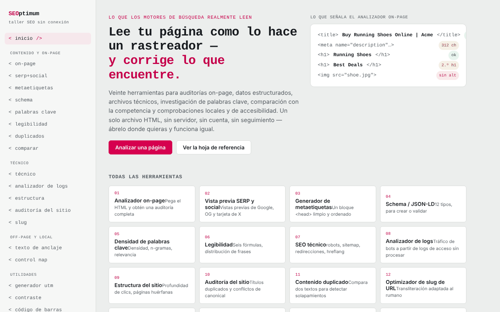

# SEOptimum

[English](README.md) · [Română](README.ro.md) · [Français](README.fr.md) · [Italiano](README.it.md) · **Español** · [Português](README.pt.md) · [Deutsch](README.de.md) · [Magyar](README.hu.md)

**Versión:** 1.3.3 · **Última actualización:** 2026-10-22

Idiomas de la interfaz: **Română, English, Français, Italiano, Español, Português (PT), Deutsch, Magyar**

Taller SEO en un único archivo HTML: veinte herramientas que se ejecutan en el navegador.

**Aplicación en línea:** https://chiuta.github.io/SEOptimum/

## Qué es

SEOptimum («offline SEO workbench») reúne herramientas para la auditoría on-page, los datos estructurados, los archivos técnicos, el contenido, el SEO off-page y local. El análisis se realiza en la pestaña del navegador, sobre el texto o el HTML que pegas; la aplicación no tiene cuentas ni analytics. La interfaz está disponible en inglés y rumano (botones «EN» / «RO»).

## Funciones

El menú contiene 20 herramientas, agrupadas así:

- **Content & on-page:** analizador on-page (título, encabezados, imágenes, enlaces, meta, datos estructurados, palabra clave objetivo), vista previa SERP y social (Google escritorio/móvil, Facebook/LinkedIn, X/Twitter), generador de metaetiquetas, Schema / JSON-LD (construcción y validación, vista previa del resultado enriquecido), investigación de palabras clave (densidad y n-gramas, clustering, intención y cola larga, canibalización), legibilidad (seis fórmulas, comprobación para el featured snippet), verificador de contenido duplicado, comparación de competidores.
- **Technical:** archivos técnicos (robots.txt, sitemap.xml, redirecciones, hreflang, llms.txt y otros archivos generados en la aplicación), analizador de logs, estructura interna y profundidad de clics, auditoría del sitio, optimizador de slugs.
- **Off-page & local:** analizador de texto ancla, verificador de coherencia NAP.
- **Utilities:** constructor de UTM, verificador de contraste WCAG 2.2, validador de GTIN / códigos de barras (UPC-A, EAN-8, EAN-13, GTIN-14).
- **Reference:** lista de verificación SEO (exportación a Markdown) y ficha de referencia.
- **Comprobación rápida de datos estructurados:** en el analizador on-page, cada bloque JSON-LD encontrado tiene el botón «Comprobar los campos obligatorios en la herramienta Schema →», que lo envía a la pestaña Validate y ejecuta la validación.
- **Atajo de teclado:** `Ctrl/Cmd+Intro` en un campo de texto pulsa el botón principal más cercano (Analyze, Generate, Check, etc.).
- Exportación del informe on-page (`on-page-report.md`) e impresión.

## Manual de uso

1. Abre la página y elige el idioma con «EN» / «RO»; el tema se puede cambiar desde la cabecera.
2. En el menú de la izquierda elige una herramienta (por ejemplo `<on-page/>`).
3. En el analizador on-page pega el código fuente HTML de la página (en el navegador: Ctrl/Cmd+U, copiar) en «Page HTML source», rellena opcionalmente «Focus keyword» y pulsa «Analyze».
4. Opcionalmente, rellena «Page URL» y pulsa «Try fetch» para intentar la descarga directa; la mayoría de los sitios bloquean la solicitud (CORS), en cuyo caso se usa el pegado manual.
5. Usa «Export report» para descargar el informe `.md` o «Print report».
6. En los generadores (meta, schema, UTM, etc.) rellena los campos y pulsa «Copy».
7. En el UTM builder, «Save to list» conserva los enlaces guardados en este navegador.
8. En la «SEO audit checklist» marca los puntos; el estado se conserva localmente y la exportación produce `seo-checklist.md`.

## Privacidad y red

- **Almacenamiento local:** `localStorage`, claves con el prefijo `seoFF.` (idioma, tema, lista UTM guardada, estado de la lista de verificación).
- **Red:** la aplicación realiza solicitudes solo ante acciones explícitas del usuario: el botón «Try fetch» (`fetch` a la URL que introduces, a cualquier sitio) y la vista previa de una imagen `og:image` indicada por URL (el navegador carga la imagen desde esa URL). La CSP de la página permite estas conexiones (`connect-src *`, `img-src https: http:`). Por lo demás, el análisis se realiza en local; no hay CDN, fuentes externas ni analytics.
- Los dominios `example.com`, `schema.org`, etc. del código aparecen como ejemplos o identificadores de vocabulario, no como recursos cargados.

- **CSP:** los scripts solo se permiten mediante un hash `sha256` (sin `'unsafe-inline'` para scripts); la ventana de impresión del informe ya no usa script en línea (la impresión se inicia desde la pestaña principal). Los estilos en línea siguen permitidos.

## Ejecución local / sin conexión

Descarga `index.html` y ábrelo en el navegador; funciona sin internet. Solo «Try fetch» y la vista previa de imágenes remotas necesitan conexión.

## Licencia

MIT para el código y la estructura de la aplicación — véase el archivo `LICENSE`. Las eventuales bibliotecas de terceros incluidas en el archivo conservan sus propias licencias.

## Auditoría

Auditoría: 2026-10-10 — verificado con Playwright y axe-core (WCAG 2.1 AA); se corrigieron el contraste de colores y el desbordamiento horizontal en pantallas estrechas. La directiva `frame-ancestors` se eliminó de la meta CSP (los navegadores la ignoran en `<meta>`; solo funciona como cabecera HTTP, algo que GitHub Pages no permite). `connect-src *` e `img-src https: http:` siguen siendo amplios a propósito, porque «Try fetch» y la vista previa de `og:image` cargan URL arbitrarias introducidas por el usuario; no se pueden restringir sin romper la función.

## Autor

Alexio — Alexandru-Ionuț Chiuță, contacto: alexio@trom.tf

## Resumen

SEOptimum es un taller SEO en un único archivo con 20 herramientas (analizador on-page, vista previa SERP/social, generadores de meta y JSON-LD, investigación de palabras clave, legibilidad, robots/sitemap/hreflang/llms.txt, analizador de logs, auditoría del sitio, constructor de UTM, contraste WCAG, validador de GTIN, lista de verificación). Interfaz en inglés/rumano. El análisis se ejecuta en local; la red solo se usa para el botón opcional «Try fetch» y las vistas previas remotas de og:image. Las preferencias se guardan en localStorage (claves `seoFF.`).

## Fuentes verificadas el 11.10.2026

- La lista de bots de IA de la ficha de referencia (GPTBot, OAI-SearchBot, ChatGPT-User, ClaudeBot, Claude-SearchBot, Claude-User, PerplexityBot, Google-Extended, etc.) se volvió a comprobar con guías públicas de 2026 (p. ej. searchenginejournal.com/ai-crawler-user-agents-list, anagram.ai/blog/ai-crawler-user-agent-list-2026-14-bots-and-robotstxt-tokens-to-know); los nombres coinciden, pero el comportamiento de los bots cambia — la lista sigue marcada como perecedera en la aplicación.

## Historial / Changelog

### 1.3.3 — 2026-10-22
- Accesibilidad: la página expone exactamente un encabezado de nivel 1 por vista (los títulos de las herramientas son elementos de nivel 2 anunciados como nivel 1, así que el aspecto no cambia).
- Móvil: todo el texto pequeño pasa a un mínimo de 12 px; la demostración de la portada ya no se sale de una pantalla de 360 px.

### 1.3.2 — 2026-10-22
- El texto de ejemplo (placeholder) de la pestaña llms.txt («Running shoes and gear, tested by trail runners.») ahora está traducido a todos los idiomas de la interfaz.

### 1.3.1 — 2026-10-22
- Correcciones de traducción: el título de la página y las metaetiquetas siguen el idioma de la interfaz; las etiquetas, marcadores y textos de demostración de los formularios de datos estructurados (schema) se traducen a los 8 idiomas.

- 1.2.0 — 2026-10-18: En «On-page», enlace a ScryVeil con el dominio del campo URL (solo enlace, sin solicitud de red; oculto para IP/localhost).
- 1.1.0 — 2026-10-14: Copia de seguridad y etiquetado de datos (fff-kit).

- 1.0.0 — 2026-10-12: la versión y la fecha de la última actualización se muestran en la aplicación
- **11 de octubre de 2026** (ronda 7) — el analizador on-page reconoce también la forma antigua `<meta http-equiv="Content-Type" content="...; charset=...">` (antes informaba falsamente «Charset not set»); la ausencia total de charset sigue siendo una advertencia (WARN), verificado con dos páginas de prueba; 0 errores, axe 0 infracciones a 1280×800 y 360×740.
- **11 de octubre de 2026** — CSP con hash para el script (sin `'unsafe-inline'` en `script-src`) y `form-action 'none'`; botón para comprobar los bloques JSON-LD del analizador on-page en el validador Schema; atajo Ctrl/Cmd+Intro; eliminadas dos capturas extraviadas (`s_1280.png`, `s_360.png`); probado con CSP activa (0 errores, axe-core 0 infracciones a 1280×800 y 360×740).
- **11 de octubre de 2026** — descripción de Schema / JSON-LD (EN y RO): indica explícitamente la pestaña «Validate / Validează» (descubribilidad); la nota sobre los bots de IA menciona la nueva comprobación del 11.10.2026; verificado con Playwright y axe-core (0 infracciones a 1280×800 y 360×740, sin desbordamiento horizontal). La aplicación no tiene número de versión.
