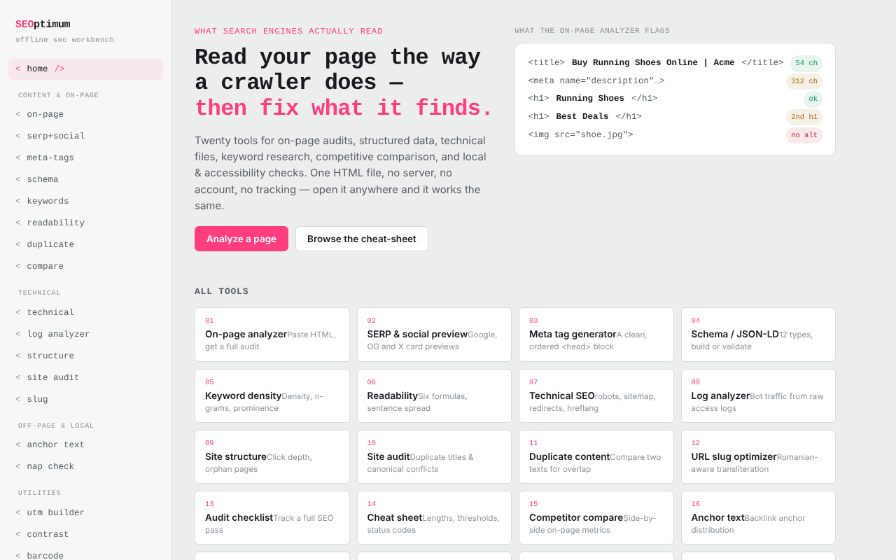

# SEOptimum

[English](README.md) · [Română](README.ro.md) · **Français** · [Italiano](README.it.md) · [Español](README.es.md) · [Português](README.pt.md) · [Deutsch](README.de.md) · [Magyar](README.hu.md)

**Version :** 1.3.0 · **Dernière mise à jour :** 2026-10-19

Langues de l'interface : **Română, English, Français, Italiano, Español, Português (PT), Deutsch, Magyar**

Atelier SEO dans un seul fichier HTML : vingt outils qui s'exécutent dans le navigateur.

**Application en ligne :** https://chiuta.github.io/SEOptimum/

## De quoi s'agit-il

SEOptimum (« offline SEO workbench ») réunit des outils pour l'audit on-page, les données structurées, les fichiers techniques, le contenu, le SEO off-page et local. L'analyse se fait dans l'onglet du navigateur, sur le texte ou le HTML que vous collez ; l'application n'a ni comptes ni analytics. L'interface est disponible en anglais et en roumain (boutons « EN » / « RO »).

## Fonctions

Le menu contient 20 outils, regroupés ainsi :

- **Content & on-page :** analyseur on-page (titre, intertitres, images, liens, méta, données structurées, mot-clé cible), aperçu SERP et réseaux sociaux (Google ordinateur/mobile, Facebook/LinkedIn, X/Twitter), générateur de balises méta, Schema / JSON-LD (construction et validation, aperçu du résultat enrichi), recherche de mots-clés (densité et n-grammes, clustering, intention et longue traîne, cannibalisation), lisibilité (six formules, vérification pour le featured snippet), vérificateur de contenu dupliqué, comparaison de concurrents.
- **Technical :** fichiers techniques (robots.txt, sitemap.xml, redirections, hreflang, llms.txt et autres fichiers générés dans l'application), analyseur de logs, structure interne et profondeur de clic, audit de site, optimiseur de slugs.
- **Off-page & local :** analyseur de textes d'ancre, vérificateur de cohérence NAP.
- **Utilities :** constructeur UTM, vérificateur de contraste WCAG 2.2, validateur GTIN / code-barres (UPC-A, EAN-8, EAN-13, GTIN-14).
- **Reference :** liste de contrôle SEO (export Markdown) et fiche de référence.
- **Vérification rapide des données structurées :** dans l'analyseur on-page, chaque bloc JSON-LD trouvé a le bouton « Vérifier les champs obligatoires dans l'outil Schema → », qui l'envoie dans l'onglet Validate et lance la validation.
- **Raccourci clavier :** `Ctrl/Cmd+Entrée` dans un champ texte active le bouton principal le plus proche (Analyze, Generate, Check, etc.).
- Export du rapport on-page (`on-page-report.md`) et impression.

## Mode d'emploi

1. Ouvrez la page et choisissez la langue avec « EN » / « RO » ; le thème peut être changé depuis l'en-tête.
2. Dans le menu de gauche, choisissez un outil (par exemple `<on-page/>`).
3. Dans l'analyseur on-page, collez le code source HTML de la page (dans le navigateur : Ctrl/Cmd+U, copier) dans « Page HTML source », renseignez éventuellement « Focus keyword » et cliquez sur « Analyze ».
4. Facultativement, renseignez « Page URL » et cliquez sur « Try fetch » pour tenter un téléchargement direct ; la plupart des sites bloquent la requête (CORS), auquel cas vous collez manuellement.
5. Utilisez « Export report » pour télécharger le rapport `.md` ou « Print report ».
6. Dans les générateurs (meta, schema, UTM, etc.), renseignez les champs et cliquez sur « Copy ».
7. Dans l'UTM builder, « Save to list » conserve les liens enregistrés dans ce navigateur.
8. Dans la « SEO audit checklist », cochez les points ; l'état est conservé localement, et l'export produit `seo-checklist.md`.

## Confidentialité et réseau

- **Stockage local :** `localStorage`, clés préfixées par `seoFF.` (langue, thème, liste UTM enregistrée, état de la checklist).
- **Réseau :** l'application n'envoie de requêtes que sur action explicite de l'utilisateur : le bouton « Try fetch » (`fetch` vers l'URL que vous saisissez, vers n'importe quel site) et l'aperçu d'une image `og:image` indiquée par URL (le navigateur charge l'image depuis cette URL). La CSP de la page autorise ces connexions (`connect-src *`, `img-src https: http:`). Pour le reste, l'analyse est locale ; il n'y a ni CDN, ni polices externes, ni analytics.
- Les domaines `example.com`, `schema.org`, etc. présents dans le code apparaissent comme exemples ou identifiants de vocabulaire, et non comme ressources chargées.

- **CSP :** les scripts ne sont autorisés que par un hash `sha256` (pas de `'unsafe-inline'` pour les scripts) ; la fenêtre d'impression du rapport n'utilise plus de script en ligne (l'impression est lancée depuis l'onglet principal). Les styles en ligne restent autorisés.

## Exécution locale / hors ligne

Téléchargez `index.html` et ouvrez-le dans un navigateur ; il fonctionne sans internet. Seuls « Try fetch » et l'aperçu des images distantes nécessitent une connexion.

## Licence

MIT pour le code et la structure de l'application — voir le fichier `LICENSE`. Les éventuelles bibliothèques tierces incluses dans le fichier conservent leurs propres licences.

## Audit

Audit : 2026-10-10 — vérifié avec Playwright et axe-core (WCAG 2.1 AA) ; le contraste des couleurs et le débordement horizontal sur écran étroit ont été corrigés. La directive `frame-ancestors` a été retirée de la méta CSP (les navigateurs l'ignorent dans `<meta>` ; elle ne fonctionne que comme en-tête HTTP, ce que GitHub Pages ne permet pas). `connect-src *` et `img-src https: http:` restent volontairement larges, car « Try fetch » et l'aperçu `og:image` chargent des URL arbitraires saisies par l'utilisateur ; elles ne peuvent pas être restreintes sans casser la fonction.

## Auteur

Alexio — Alexandru-Ionuț Chiuță, contact : alexio@trom.tf

## Résumé

SEOptimum est un atelier SEO dans un seul fichier avec 20 outils (analyseur on-page, aperçu SERP/réseaux sociaux, générateurs de méta et de JSON-LD, recherche de mots-clés, lisibilité, robots/sitemap/hreflang/llms.txt, analyseur de logs, audit de site, constructeur UTM, contraste WCAG, validateur GTIN, checklist). Interface en anglais/roumain. L'analyse s'exécute localement ; le réseau n'est utilisé que pour le bouton facultatif « Try fetch » et les aperçus og:image distants. Les préférences sont stockées dans localStorage (clés `seoFF.`).

## Sources vérifiées le 11.10.2026

- La liste des robots d'IA de la fiche de référence (GPTBot, OAI-SearchBot, ChatGPT-User, ClaudeBot, Claude-SearchBot, Claude-User, PerplexityBot, Google-Extended, etc.) a été revérifiée par rapport à des guides publics de 2026 (par ex. searchenginejournal.com/ai-crawler-user-agents-list, anagram.ai/blog/ai-crawler-user-agent-list-2026-14-bots-and-robotstxt-tokens-to-know) ; les noms coïncident, mais le comportement des robots change — la liste reste marquée comme périssable dans l'application.

## Historique / Changelog

- 1.2.0 — 2026-10-18 : Dans « On-page », lien vers ScryVeil avec le domaine du champ URL (lien seulement, sans requête réseau ; masqué pour IP/localhost).
- 1.1.0 — 2026-10-14 : Sauvegarde et étiquetage des données (fff-kit).

- 1.0.0 — 2026-10-12 : la version et la date de la dernière mise à jour sont affichées dans l'application
- **11 octobre 2026** (tour 7) — l'analyseur on-page reconnaît aussi l'ancienne forme `<meta http-equiv="Content-Type" content="...; charset=...">` (auparavant il signalait à tort « Charset not set ») ; l'absence totale de charset reste un avertissement (WARN), vérifié avec deux pages de test ; 0 erreur, axe 0 violation à 1280×800 et 360×740.
- **11 octobre 2026** — CSP avec hash pour le script (sans `'unsafe-inline'` dans `script-src`) et `form-action 'none'` ; bouton de vérification des blocs JSON-LD de l'analyseur on-page dans le validateur Schema ; raccourci Ctrl/Cmd+Entrée ; suppression de deux captures égarées (`s_1280.png`, `s_360.png`) ; testé avec la CSP active (0 erreur, axe-core 0 violation à 1280×800 et 360×740).
- **11 octobre 2026** — description Schema / JSON-LD (EN et RO) : indique explicitement l'onglet « Validate / Validează » (découvrabilité) ; la note sur les robots d'IA mentionne la revérification du 11.10.2026 ; vérifié avec Playwright et axe-core (0 violation à 1280×800 et 360×740, sans débordement horizontal). L'application n'a pas de numéro de version.
