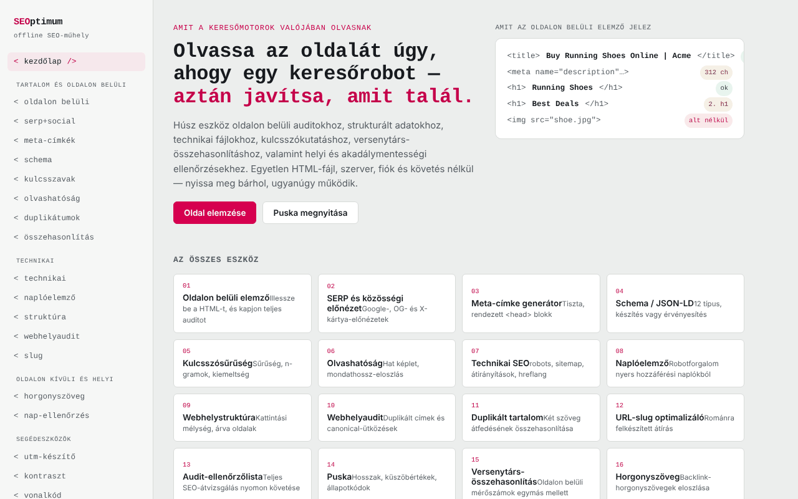

# SEOptimum

[English](README.md) · [Română](README.ro.md) · [Français](README.fr.md) · [Italiano](README.it.md) · [Español](README.es.md) · [Português](README.pt.md) · [Deutsch](README.de.md) · **Magyar**

**Verzió:** 2.2.0 · **Utolsó frissítés:** 2026-10-27

A felület nyelvei: **Română, English, Français, Italiano, Español, Português (PT), Deutsch, Magyar**

SEO-műhely egyetlen HTML-fájlban: húsz eszköz, amely a böngészőben fut.

**Online alkalmazás:** https://chiuta.github.io/SEOptimum/

## Mi ez

A SEOptimum („offline SEO workbench”) eszközöket fog össze az on-page audithoz, a strukturált adatokhoz, a technikai fájlokhoz, a tartalomhoz, valamint az off-page és a helyi SEO-hoz. Az elemzés a böngészőfülön belül történik, az általad beillesztett szövegen vagy HTML-en; az alkalmazásnak nincsenek fiókjai, és nincs analitikája. A felület angolul és románul érhető el („EN” / „RO” gombok).

## Funkciók

A menü 20 eszközt tartalmaz, a következő csoportosításban:

- **Content & on-page:** on-page elemző (cím, címsorok, képek, hivatkozások, meta, strukturált adatok, célkulcsszó), SERP- és közösségi előnézet (Google asztali/mobil, Facebook/LinkedIn, X/Twitter), metacímke-generátor, Schema / JSON-LD (összeállítás és validálás, rich result előnézet), kulcsszókutatás (sűrűség és n-gramok, klaszterezés, szándék és long tail, kannibalizáció), olvashatóság (hat képlet, featured snippet ellenőrzés), duplikált tartalom ellenőrző, versenytárs-összehasonlítás.
- **Technical:** technikai fájlok (robots.txt, sitemap.xml, átirányítások, hreflang, llms.txt és más, az alkalmazásban generált fájlok), naplóelemző, belső struktúra és kattintási mélység, webhelyaudit, slug-optimalizáló.
- **Off-page & local:** horgonyszöveg-elemző, NAP-konzisztencia ellenőrző.
- **Utilities:** UTM-építő, WCAG 2.2 kontrasztellenőrző, GTIN / vonalkód-validátor (UPC-A, EAN-8, EAN-13, GTIN-14).
- **Reference:** SEO-ellenőrzőlista (Markdown-export) és referencialap.
- **Strukturált adatok gyors ellenőrzése:** az on-page elemzőben minden megtalált JSON-LD blokkhoz tartozik egy „Kötelező mezők ellenőrzése a Schema eszközben →” gomb, amely a Validate fülre küldi, és lefuttatja a validálást.
- **Billentyűparancs:** a `Ctrl/Cmd+Enter` egy szövegmezőben megnyomja a legközelebbi fő gombot (Analyze, Generate, Check stb.).
- Az on-page jelentés exportálása (`on-page-report.md`) és nyomtatása.

## Használati útmutató

1. Nyisd meg az oldalt, és válaszd ki a nyelvet az „EN” / „RO” gombokkal; a téma a fejlécből módosítható.
2. A bal oldali menüből válassz egy eszközt (például `<on-page/>`).
3. Az on-page elemzőben illeszd be az oldal HTML-forrását (a böngészőben: Ctrl/Cmd+U, másolás) a „Page HTML source” mezőbe, opcionálisan töltsd ki a „Focus keyword” mezőt, és nyomd meg az „Analyze” gombot.
4. Opcionálisan töltsd ki a „Page URL” mezőt, és nyomd meg a „Try fetch” gombot a közvetlen letöltés kipróbálásához; a legtöbb webhely blokkolja a kérést (CORS), ilyenkor a kézi beillesztést használd.
5. Az „Export report” gombbal töltsd le a `.md` jelentést, vagy használd a „Print report” gombot.
6. A generátorokban (meta, schema, UTM stb.) töltsd ki a mezőket, és nyomd meg a „Copy” gombot.
7. Az UTM builderben a „Save to list” ebben a böngészőben őrzi meg a mentett hivatkozásokat.
8. A „SEO audit checklist” listán jelöld be a pontokat; az állapot helyben megmarad, az export pedig a `seo-checklist.md` fájlt állítja elő.

## Adatvédelem és hálózat

- **Helyi tárolás:** `localStorage`, `seoFF.` előtagú kulcsok (nyelv, téma, mentett UTM-lista, az ellenőrzőlista állapota).
- **Hálózat:** az alkalmazás csak a felhasználó kifejezett műveletei esetén indít kéréseket: a „Try fetch” gomb (`fetch` az általad megadott URL-re, bármely webhelyre) és az URL-lel megadott `og:image` kép előnézete (a böngésző arról az URL-ről tölti be a képet). Az oldal CSP-je engedélyezi ezeket a kapcsolatokat (`connect-src *`, `img-src https: http:`). Egyebekben az elemzés helyben történik; nincs CDN, külső betűtípus vagy analitika.
- A kódban szereplő `example.com`, `schema.org` stb. tartományok példaként vagy szókincs-azonosítóként jelennek meg, nem betöltött erőforrásként.

- **CSP:** a szkriptek kizárólag `sha256` hash-sel engedélyezettek (szkriptekhez nincs `'unsafe-inline'`); a jelentés nyomtatási ablaka már nem használ beágyazott szkriptet (a nyomtatást a főfülről indítják). A beágyazott stílusok továbbra is engedélyezettek.

## Futtatás helyben / offline

Töltsd le az `index.html` fájlt, és nyisd meg a böngészőben; internet nélkül is működik. Csak a „Try fetch” és a távoli képek előnézete igényel kapcsolatot.

## Licenc

MIT az alkalmazás kódjára és szerkezetére — lásd a `LICENSE` fájlt. A fájlba esetleg beépített harmadik féltől származó függvénykönyvtárak megtartják saját licencüket.

## Audit

Audit: 2026-10-10 — Playwrighttal és axe-core-ral (WCAG 2.1 AA) ellenőrizve; javították a színkontrasztot és a vízszintes túlcsordulást keskeny képernyőn. A `frame-ancestors` direktívát eltávolították a CSP meta címkéből (a böngészők figyelmen kívül hagyják a `<meta>`-ban; csak HTTP-fejlécként működik, amit a GitHub Pages nem tesz lehetővé). A `connect-src *` és az `img-src https: http:` szándékosan tágak maradnak, mert a „Try fetch” és az `og:image` előnézet a felhasználó által megadott tetszőleges URL-eket tölt be; a funkció tönkretétele nélkül nem szűkíthetők.

## Szerző

Alexio — Alexandru-Ionuț Chiuță, kapcsolat: alexio@trom.tf

## Összefoglaló

A SEOptimum egyetlen fájlból álló SEO-műhely 20 eszközzel (on-page elemző, SERP-/közösségi előnézet, meta- és JSON-LD-generátorok, kulcsszókutatás, olvashatóság, robots/sitemap/hreflang/llms.txt, naplóelemző, webhelyaudit, UTM-építő, WCAG-kontraszt, GTIN-validátor, ellenőrzőlista). Angol/román felület. Az elemzés helyben fut; a hálózatot csak az opcionális „Try fetch” gomb és a távoli og:image előnézetek használják. A beállítások a localStorage-ban vannak tárolva (`seoFF.` kulcsok).

## 2026. 10. 11-én ellenőrzött források

- A referencialapon szereplő MI-botok listáját (GPTBot, OAI-SearchBot, ChatGPT-User, ClaudeBot, Claude-SearchBot, Claude-User, PerplexityBot, Google-Extended stb.) újra ellenőrizték 2026-os nyilvános útmutatókkal szemben (pl. searchenginejournal.com/ai-crawler-user-agents-list, anagram.ai/blog/ai-crawler-user-agent-list-2026-14-bots-and-robotstxt-tokens-to-know); a nevek egyeznek, de a botok viselkedése változik — a lista az alkalmazásban továbbra is múlandóként van megjelölve.

## Előzmények / Changelog

### 1.3.9 — 2026-10-23

- Az űrlapmezők programozottan társított címkékkel rendelkeznek (`for`/`aria-labelledby`), nem csak a `placeholder`-re támaszkodnak.

### 1.3.8 — 2026-10-23

- Legalább 44 px-es érintési célpontok érintőeszközökön (`pointer:coarse`); az asztali nézet változatlan.

### 1.3.7 — 2026-10-23

- A natív `confirm()` párbeszédablakokat az akadálymentes, lefordított `FFF.dialog` váltotta fel (kit 1.2.0); a működés változatlan.

### 1.3.5 — 2026-10-22

fff-kit 1.1.4: érintési célok és minimális szövegméret.

### 1.3.4 — 2026-10-22
- fff-kit 1.1.2: PBKDF2 600 000 iterációval, clickjacking elleni védelem

### 1.3.3 — 2026-10-22
- Akadálymentesség: az oldal nézetenként pontosan egy 1. szintű címsort tesz közzé (az eszközök címei 2. szintű elemek, 1. szintűként felolvasva, így a megjelenés nem változik).
- Mobil: minden kis szöveg legalább 12 px; a kezdőlap bemutatója már nem lóg túl egy 360 px-es képernyőn.

### 1.3.2 — 2026-10-22
- Az llms.txt fül példa-helyőrzője („Running shoes and gear, tested by trail runners.”) mostantól minden felületi nyelven le van fordítva.

### 1.3.1 — 2026-10-22
- Fordítási javítások: az oldalcím és a meta címkék követik a felület nyelvét; a strukturált adatok (schema) űrlapjainak címkéi, helyőrzői és bemutató szövegei mind a 8 nyelven fordítva vannak.

- 1.2.0 — 2026-10-18: Az „On-page” részben hivatkozás a ScryVeilre az URL-mezőben szereplő tartománnyal (csak hivatkozás, hálózati kérés nélkül; IP/localhost esetén rejtett).
- 1.1.0 — 2026-10-14: Biztonsági mentés és adatcímkézés (fff-kit).

- 1.0.0 — 2026-10-12: a verzió és az utolsó frissítés dátuma megjelenik az alkalmazásban
- **2026. október 11.** (7. kör) — az on-page elemző felismeri a régi `<meta http-equiv="Content-Type" content="...; charset=...">` alakot is (korábban tévesen „Charset not set” hibát jelzett); a charset teljes hiánya továbbra is figyelmeztetés (WARN), két tesztoldallal ellenőrizve; 0 hiba, axe 0 szabálysértés 1280×800 és 360×740 mellett.
- **2026. október 11.** — CSP hash-sel a szkripthez (a `script-src`-ben nincs `'unsafe-inline'`) és `form-action 'none'`; gomb az on-page elemző JSON-LD blokkjainak a Schema validátorban való ellenőrzéséhez; Ctrl/Cmd+Enter billentyűparancs; két eltévedt képernyőkép eltávolítva (`s_1280.png`, `s_360.png`); aktív CSP mellett tesztelve (0 hiba, axe-core 0 szabálysértés 1280×800 és 360×740 mellett).
- **2026. október 11.** — Schema / JSON-LD leírás (EN és RO): kifejezetten a „Validate / Validează” fülre mutat (felfedezhetőség); az MI-botokról szóló megjegyzés említi a 2026. 10. 11-i újraellenőrzést; Playwrighttal és axe-core-ral ellenőrizve (0 szabálysértés 1280×800 és 360×740 mellett, vízszintes túlcsordulás nélkül). Az alkalmazásnak nincs verziószáma.
