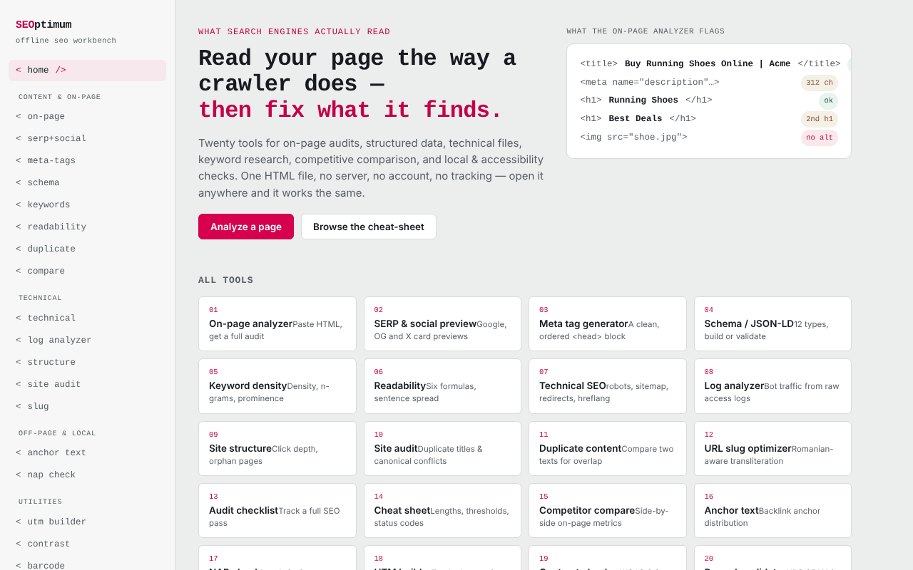

# SEOptimum

**English** · [Română](README.ro.md) · [Français](README.fr.md) · [Italiano](README.it.md) · [Español](README.es.md) · [Português](README.pt.md) · [Deutsch](README.de.md) · [Magyar](README.hu.md)

**Version:** 1.3.2 · **Last updated:** 2026-10-22

Interface languages: **Română, English, Français, Italiano, Español, Português (PT), Deutsch, Magyar**

An SEO workshop in a single HTML file: twenty tools that run in the browser.

**Live app:** https://chiuta.github.io/SEOptimum/

## What it is

SEOptimum ("offline SEO workbench") brings together tools for on-page auditing, structured data, technical files, content, off-page and local SEO. The analysis is done in the browser tab, on the text or HTML you paste; the app has no accounts and no analytics. The interface is available in English and Romanian (the "EN" / "RO" buttons).

## Features

The menu contains 20 tools, grouped as follows:

- **Content & on-page:** on-page analyzer (title, headings, images, links, meta, structured data, target keyword), SERP and social preview (Google desktop/mobile, Facebook/LinkedIn, X/Twitter), meta tag generator, Schema / JSON-LD (building and validation, rich result preview), keyword research (density and n-grams, clustering, intent and long-tail, cannibalization), readability (six formulas, featured snippet check), duplicate content checker, competitor comparison.
- **Technical:** technical files (robots.txt, sitemap.xml, redirects, hreflang, llms.txt and other files generated in the app), log analyzer, internal structure and click depth, site audit, slug optimizer.
- **Off-page & local:** anchor text analyzer, NAP consistency checker.
- **Utilities:** UTM builder, WCAG 2.2 contrast checker, GTIN / barcode validator (UPC-A, EAN-8, EAN-13, GTIN-14).
- **Reference:** SEO checklist (Markdown export) and reference sheet.
- **Quick structured-data check:** in the on-page analyzer, every JSON-LD block found has the button "Check required fields in the Schema tool →", which sends it to the Validate tab and runs the validation.
- **Keyboard shortcut:** `Ctrl/Cmd+Enter` in a text field presses the nearest main button (Analyze, Generate, Check, etc.).
- On-page report export (`on-page-report.md`) and printing.

## User guide

1. Open the page and choose the language with "EN" / "RO"; the theme can be changed from the header.
2. From the left-hand menu choose a tool (for example `<on-page/>`).
3. In the on-page analyzer, paste the page's HTML source (in the browser: Ctrl/Cmd+U, copy) into "Page HTML source", optionally fill in "Focus keyword" and press "Analyze".
4. Optionally, fill in "Page URL" and press "Try fetch" to attempt a direct download; most sites block the request (CORS), in which case you use manual pasting.
5. Use "Export report" to download the `.md` report or "Print report".
6. In the generators (meta, schema, UTM, etc.) fill in the fields and press "Copy".
7. In the UTM builder, "Save to list" keeps the saved links in this browser.
8. In the "SEO audit checklist" tick the items; the state is kept locally, and the export produces `seo-checklist.md`.

## Privacy and network

- **Local storage:** `localStorage`, keys with the prefix `seoFF.` (language, theme, saved UTM list, checklist state).
- **Network:** the app makes requests only on explicit user actions: the "Try fetch" button (`fetch` to the URL you enter, to any site) and the preview of an `og:image` image given by URL (the browser loads the image from that URL). The page's CSP allows these connections (`connect-src *`, `img-src https: http:`). Otherwise the analysis takes place locally; there is no CDN, external fonts or analytics.
- The domains `example.com`, `schema.org`, etc. in the code appear as examples or vocabulary identifiers, not as loaded resources.

- **CSP:** scripts are allowed only via a `sha256` hash (no `'unsafe-inline'` for scripts); the report print window no longer uses an inline script (printing is started from the main tab). Inline styles remain allowed.

## Running locally / offline

Download `index.html` and open it in a browser; it works without internet. Only "Try fetch" and the preview of remote images need a connection.

## License

MIT for the app's code and structure — see the `LICENSE` file. Any third-party libraries included in the file keep their own licenses.

## Audit

Audit: 2026-10-10 — verified with Playwright and axe-core (WCAG 2.1 AA); colour contrast and horizontal overflow on narrow screens were fixed. The `frame-ancestors` directive was removed from the CSP meta (browsers ignore it in `<meta>`; it works only as an HTTP header, which GitHub Pages does not allow). `connect-src *` and `img-src https: http:` remain intentionally broad, because "Try fetch" and the `og:image` preview load arbitrary URLs entered by the user; they cannot be restricted without breaking the feature.

## Author

Alexio — Alexandru-Ionuț Chiuță, contact: alexio@trom.tf

## Summary

SEOptimum is a single-file SEO workbench with 20 tools (on-page analyzer, SERP/social preview, meta and JSON-LD generators, keyword research, readability, robots/sitemap/hreflang/llms.txt, log analyzer, site audit, UTM builder, WCAG contrast, GTIN validator, checklist). English/Romanian UI. Analysis runs locally; the network is used only for the optional "Try fetch" button and remote og:image previews. Preferences are stored in localStorage (`seoFF.` keys).

## Sources verified on 11.10.2026

- The list of AI bots in the reference sheet (GPTBot, OAI-SearchBot, ChatGPT-User, ClaudeBot, Claude-SearchBot, Claude-User, PerplexityBot, Google-Extended, etc.) was re-checked against public guides from 2026 (e.g. searchenginejournal.com/ai-crawler-user-agents-list, anagram.ai/blog/ai-crawler-user-agent-list-2026-14-bots-and-robotstxt-tokens-to-know); the names match, but the bots' behaviour changes — the list remains marked as perishable in the app.

## History / Changelog

### 1.3.2 — 2026-10-22
- The hidden example placeholder of the llms.txt tab (“Running shoes and gear, tested by trail runners.”) is now translated in all interface languages.

### 1.3.1 — 2026-10-22
- Translation fixes: page title and meta tags follow the interface language; structured-data (schema) form labels, placeholders and demo texts are now translated in all 8 languages.

- 1.2.0 — 2026-10-18: In "On-page", a link to ScryVeil with the domain from the URL field (link only, no network request; hidden for IP/localhost).
- 1.1.0 — 2026-10-14: Backup and data labelling (fff-kit).

- 1.0.0 — 2026-10-12: the version and the date of the last update are displayed in the app
- **11 October 2026** (round 7) — the on-page analyzer also recognises the old form `<meta http-equiv="Content-Type" content="...; charset=...">` (previously it falsely reported "Charset not set"); a complete lack of charset remains a warning (WARN), verified with two test pages; 0 errors, axe 0 violations at 1280×800 and 360×740.
- **11 October 2026** — CSP with a hash for the script (no `'unsafe-inline'` in `script-src`) and `form-action 'none'`; button for checking the JSON-LD blocks of the on-page analyzer in the Schema validator; the Ctrl/Cmd+Enter shortcut; two stray screenshots removed (`s_1280.png`, `s_360.png`); tested with CSP active (0 errors, axe-core 0 violations at 1280×800 and 360×740).
- **11 October 2026** — Schema / JSON-LD description (EN and RO): explicitly points to the "Validate" tab (discoverability); the note on AI bots mentions the re-check of 11.10.2026; verified with Playwright and axe-core (0 violations at 1280×800 and 360×740, no horizontal overflow). The app has no version number.
