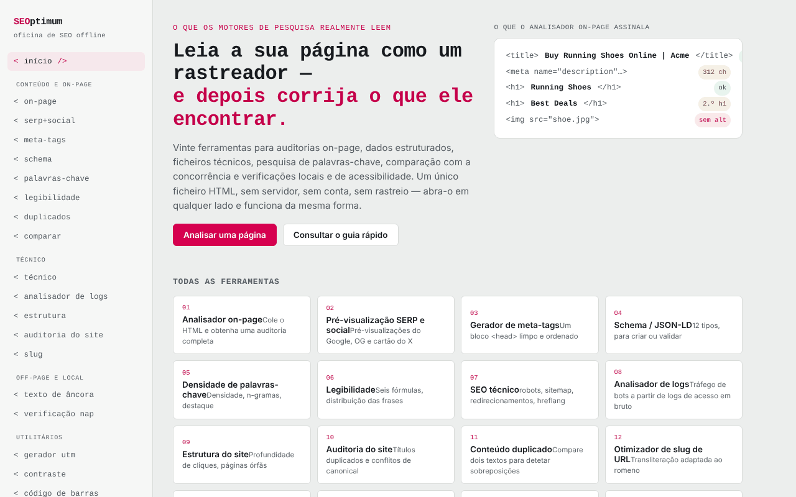

# SEOptimum

[English](README.md) · [Română](README.ro.md) · [Français](README.fr.md) · [Italiano](README.it.md) · [Español](README.es.md) · **Português** · [Deutsch](README.de.md) · [Magyar](README.hu.md)

**Versão:** 1.3.2 · **Última atualização:** 2026-10-22

Idiomas da interface: **Română, English, Français, Italiano, Español, Português (PT), Deutsch, Magyar**

Oficina SEO num único ficheiro HTML: vinte ferramentas que funcionam no navegador.

**Aplicação online:** https://chiuta.github.io/SEOptimum/

## O que é

O SEOptimum («offline SEO workbench») reúne ferramentas para auditoria on-page, dados estruturados, ficheiros técnicos, conteúdo, SEO off-page e local. A análise é feita no separador do navegador, sobre o texto ou o HTML que colar; a aplicação não tem contas nem analytics. A interface está disponível em inglês e romeno (botões «EN» / «RO»).

## Funcionalidades

O menu contém 20 ferramentas, agrupadas assim:

- **Content & on-page:** analisador on-page (título, cabeçalhos, imagens, ligações, meta, dados estruturados, palavra-chave alvo), pré-visualização SERP e social (Google computador/telemóvel, Facebook/LinkedIn, X/Twitter), gerador de metaetiquetas, Schema / JSON-LD (construção e validação, pré-visualização do resultado enriquecido), pesquisa de palavras-chave (densidade e n-gramas, clustering, intenção e cauda longa, canibalização), legibilidade (seis fórmulas, verificação para o featured snippet), verificador de conteúdo duplicado, comparação de concorrentes.
- **Technical:** ficheiros técnicos (robots.txt, sitemap.xml, redirecionamentos, hreflang, llms.txt e outros ficheiros gerados na aplicação), analisador de logs, estrutura interna e profundidade de cliques, auditoria do sítio, otimizador de slugs.
- **Off-page & local:** analisador de texto âncora, verificador de consistência NAP.
- **Utilities:** construtor de UTM, verificador de contraste WCAG 2.2, validador de GTIN / códigos de barras (UPC-A, EAN-8, EAN-13, GTIN-14).
- **Reference:** lista de verificação SEO (exportação em Markdown) e ficha de referência.
- **Verificação rápida de dados estruturados:** no analisador on-page, cada bloco JSON-LD encontrado tem o botão «Verificar os campos obrigatórios na ferramenta Schema →», que o envia para o separador Validate e executa a validação.
- **Atalho de teclado:** `Ctrl/Cmd+Enter` num campo de texto prime o botão principal mais próximo (Analyze, Generate, Check, etc.).
- Exportação do relatório on-page (`on-page-report.md`) e impressão.

## Manual de utilização

1. Abra a página e escolha o idioma com «EN» / «RO»; o tema pode ser alterado no cabeçalho.
2. No menu da esquerda escolha uma ferramenta (por exemplo `<on-page/>`).
3. No analisador on-page cole o código-fonte HTML da página (no navegador: Ctrl/Cmd+U, copiar) em «Page HTML source», preencha opcionalmente «Focus keyword» e prima «Analyze».
4. Opcionalmente, preencha «Page URL» e prima «Try fetch» para tentar a transferência direta; a maioria dos sítios bloqueia o pedido (CORS), caso em que se usa a colagem manual.
5. Use «Export report» para transferir o relatório `.md` ou «Print report».
6. Nos geradores (meta, schema, UTM, etc.) preencha os campos e prima «Copy».
7. No UTM builder, «Save to list» guarda as ligações guardadas neste navegador.
8. Na «SEO audit checklist» assinale os pontos; o estado é conservado localmente e a exportação produz `seo-checklist.md`.

## Privacidade e rede

- **Armazenamento local:** `localStorage`, chaves com o prefixo `seoFF.` (idioma, tema, lista UTM guardada, estado da lista de verificação).
- **Rede:** a aplicação só faz pedidos mediante ações explícitas do utilizador: o botão «Try fetch» (`fetch` para o URL que introduzir, para qualquer sítio) e a pré-visualização de uma imagem `og:image` indicada por URL (o navegador carrega a imagem a partir desse URL). A CSP da página permite estas ligações (`connect-src *`, `img-src https: http:`). Quanto ao resto, a análise é feita localmente; não há CDN, tipos de letra externos nem analytics.
- Os domínios `example.com`, `schema.org`, etc. presentes no código aparecem como exemplos ou identificadores de vocabulário, não como recursos carregados.

- **CSP:** os scripts só são permitidos por hash `sha256` (sem `'unsafe-inline'` para scripts); a janela de impressão do relatório já não usa script inline (a impressão é iniciada a partir do separador principal). Os estilos inline continuam permitidos.

## Execução local / offline

Transfira `index.html` e abra-o no navegador; funciona sem internet. Só «Try fetch» e a pré-visualização de imagens remotas precisam de ligação.

## Licença

MIT para o código e a estrutura da aplicação — ver o ficheiro `LICENSE`. As eventuais bibliotecas de terceiros incluídas no ficheiro mantêm as suas próprias licenças.

## Auditoria

Auditoria: 2026-10-10 — verificado com Playwright e axe-core (WCAG 2.1 AA); foram corrigidos o contraste das cores e o transbordo horizontal em ecrãs estreitos. A diretiva `frame-ancestors` foi retirada da meta CSP (os navegadores ignoram-na em `<meta>`; só funciona como cabeçalho HTTP, o que o GitHub Pages não permite). `connect-src *` e `img-src https: http:` continuam intencionalmente amplos, porque «Try fetch» e a pré-visualização de `og:image` carregam URL arbitrários introduzidos pelo utilizador; não podem ser restringidos sem estragar a funcionalidade.

## Autor

Alexio — Alexandru-Ionuț Chiuță, contacto: alexio@trom.tf

## Resumo

O SEOptimum é uma oficina SEO num único ficheiro com 20 ferramentas (analisador on-page, pré-visualização SERP/social, geradores de meta e JSON-LD, pesquisa de palavras-chave, legibilidade, robots/sitemap/hreflang/llms.txt, analisador de logs, auditoria do sítio, construtor de UTM, contraste WCAG, validador de GTIN, lista de verificação). Interface em inglês/romeno. A análise corre localmente; a rede só é usada para o botão opcional «Try fetch» e para as pré-visualizações remotas de og:image. As preferências são guardadas em localStorage (chaves `seoFF.`).

## Fontes verificadas em 11.10.2026

- A lista de bots de IA da ficha de referência (GPTBot, OAI-SearchBot, ChatGPT-User, ClaudeBot, Claude-SearchBot, Claude-User, PerplexityBot, Google-Extended, etc.) foi reverificada face a guias públicos de 2026 (p. ex. searchenginejournal.com/ai-crawler-user-agents-list, anagram.ai/blog/ai-crawler-user-agent-list-2026-14-bots-and-robotstxt-tokens-to-know); os nomes coincidem, mas o comportamento dos bots muda — a lista continua assinalada como perecível na aplicação.

## Histórico / Changelog

### 1.3.2 — 2026-10-22
- O texto de exemplo (placeholder) do separador llms.txt («Running shoes and gear, tested by trail runners.») está agora traduzido em todas as línguas da interface.

### 1.3.1 — 2026-10-22
- Correções de tradução: o título da página e as metaetiquetas seguem o idioma da interface; as etiquetas, marcadores e textos de demonstração dos formulários de dados estruturados (schema) estão traduzidos nos 8 idiomas.

- 1.2.0 — 2026-10-18: Em «On-page», ligação para o ScryVeil com o domínio do campo URL (apenas ligação, sem pedido de rede; oculta para IP/localhost).
- 1.1.0 — 2026-10-14: Cópia de segurança e etiquetagem de dados (fff-kit).

- 1.0.0 — 2026-10-12: a versão e a data da última atualização são apresentadas na aplicação
- **11 de outubro de 2026** (ronda 7) — o analisador on-page reconhece também a forma antiga `<meta http-equiv="Content-Type" content="...; charset=...">` (antes reportava falsamente «Charset not set»); a ausência total de charset continua a ser um aviso (WARN), verificado com duas páginas de teste; 0 erros, axe 0 violações a 1280×800 e 360×740.
- **11 de outubro de 2026** — CSP com hash para o script (sem `'unsafe-inline'` em `script-src`) e `form-action 'none'`; botão para verificar os blocos JSON-LD do analisador on-page no validador Schema; atalho Ctrl/Cmd+Enter; removidas duas capturas extraviadas (`s_1280.png`, `s_360.png`); testado com CSP ativa (0 erros, axe-core 0 violações a 1280×800 e 360×740).
- **11 de outubro de 2026** — descrição de Schema / JSON-LD (EN e RO): indica explicitamente o separador «Validate / Validează» (descobribilidade); a nota sobre os bots de IA menciona a reverificação de 11.10.2026; verificado com Playwright e axe-core (0 violações a 1280×800 e 360×740, sem transbordo horizontal). A aplicação não tem número de versão.
