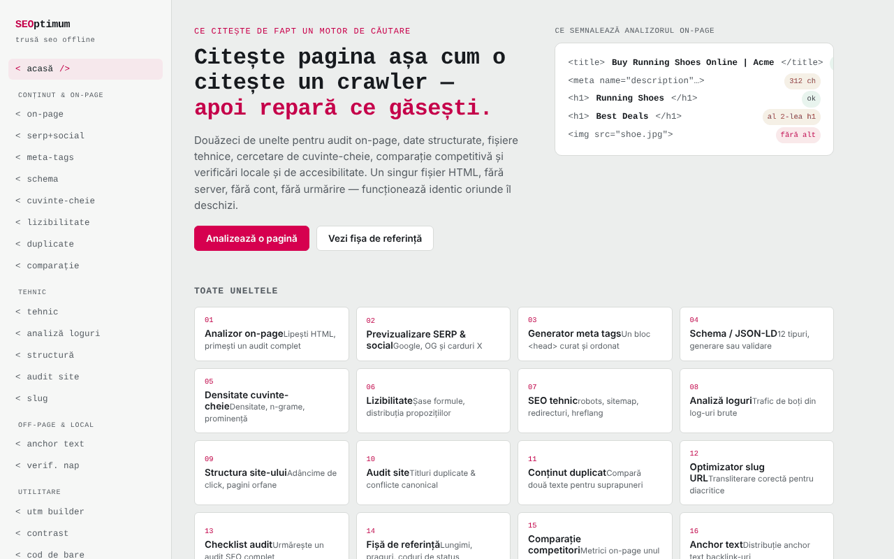

# SEOptimum

[English](README.md) · **Română** · [Français](README.fr.md) · [Italiano](README.it.md) · [Español](README.es.md) · [Português](README.pt.md) · [Deutsch](README.de.md) · [Magyar](README.hu.md)

**Versiune:** 1.3.3 · **Ultima actualizare:** 2026-10-22

Limbile interfeței: **Română, English, Français, Italiano, Español, Português (PT), Deutsch, Magyar**

Atelier SEO într-un singur fișier HTML: douăzeci de unelte care rulează în browser.

**Live:** https://chiuta.github.io/SEOptimum/

## Ce este

SEOptimum („offline SEO workbench”) reunește unelte pentru audit on-page, date structurate, fișiere tehnice, conținut, SEO off-page și local. Analiza se face în fila browserului, pe textul sau HTML-ul pe care îl lipești; aplicația nu are conturi și nu are analytics. Interfața este disponibilă în engleză și română (butoanele „EN” / „RO”).

## Funcții

Meniul conține 20 de unelte, grupate astfel:

- **Content & on-page:** analizor on-page (titlu, headinguri, imagini, linkuri, meta, date structurate, cuvânt-cheie țintă), previzualizare SERP și social (Google desktop/mobil, Facebook/LinkedIn, X/Twitter), generator de meta-taguri, Schema / JSON-LD (construire și validare, previzualizare rich result), cercetare de cuvinte-cheie (densitate și n-grame, clustering, intenție și long-tail, canibalizare), lizibilitate (șase formule, verificare pentru featured snippet), verificator de conținut duplicat, comparare de competitori.
- **Technical:** fișiere tehnice (robots.txt, sitemap.xml, redirecturi, hreflang, llms.txt și alte fișiere generate în aplicație), analizor de loguri, structură internă și adâncime de click, audit de site, optimizator de slug-uri.
- **Off-page & local:** analizor de anchor text, verificator de consistență NAP.
- **Utilities:** constructor UTM, verificator de contrast WCAG 2.2, validator GTIN / cod de bare (UPC-A, EAN-8, EAN-13, GTIN-14).
- **Reference:** listă de verificare SEO (export Markdown) și fișă de referință.
- **Verificare rapidă a datelor structurate:** în analizorul on-page, fiecare bloc JSON-LD găsit are butonul „Verifică câmpurile obligatorii în unealta Schema →”, care îl trimite în fila Validate și rulează validarea.
- **Scurtătură de tastatură:** `Ctrl/Cmd+Enter` într-un câmp text apasă butonul principal cel mai apropiat (Analyze, Generate, Check etc.).
- Export raport on-page (`on-page-report.md`) și tipărire.

## Manual de utilizare

1. Deschide pagina și alege limba cu „EN” / „RO”; tema se poate schimba din antet.
2. Din meniul din stânga alege o unealtă (de exemplu `<on-page/>`).
3. În analizorul on-page lipește sursa HTML a paginii (în browser: Ctrl/Cmd+U, copiază) în „Page HTML source”, opțional completează „Focus keyword” și apasă „Analyze”.
4. Opțional, completează „Page URL” și apasă „Try fetch” pentru a încerca descărcarea directă; majoritatea site-urilor blochează cererea (CORS), caz în care folosești lipirea manuală.
5. Folosește „Export report” pentru a descărca raportul `.md` sau „Print report”.
6. În generatoare (meta, schema, UTM etc.) completează câmpurile și apasă „Copy”.
7. La UTM builder, „Save to list” păstrează linkurile salvate în acest browser.
8. În „SEO audit checklist” bifează punctele; starea se păstrează local, iar exportul produce `seo-checklist.md`.

## Confidențialitate și rețea

- **Stocare locală:** `localStorage`, chei cu prefixul `seoFF.` (limbă, temă, listă UTM salvată, starea checklist-ului).
- **Rețea:** aplicația face cereri doar la acțiuni explicite ale utilizatorului: butonul „Try fetch” (`fetch` către URL-ul introdus de tine, către orice site) și previzualizarea unei imagini `og:image` indicate prin URL (browserul încarcă imaginea de la acel URL). Politica CSP din pagină permite aceste conexiuni (`connect-src *`, `img-src https: http:`). În rest, analiza are loc local; nu există CDN, fonturi externe sau analytics.
- Domeniile `example.com`, `schema.org` etc. din cod apar ca exemple sau identificatori de vocabular, nu ca resurse încărcate.

- **CSP:** scripturile sunt permise doar prin hash `sha256` (fără `'unsafe-inline'` pentru scripturi); fereastra de tipărire a raportului nu mai folosește script inline (tipărirea este pornită din fila principală). Stilurile inline rămân permise.

## Rulare locală / offline

Descarcă `index.html` și deschide-l în browser; funcționează fără internet. Doar „Try fetch” și previzualizarea imaginilor la distanță au nevoie de conexiune.

## Licență

MIT pentru codul și structura aplicației — vezi fișierul `LICENSE`. Eventualele biblioteci terțe incluse în fișier își păstrează licențele proprii.

## Audit

Audit: 2026-10-10 — verificat cu Playwright și axe-core (WCAG 2.1 AA); corectate contrastul culorilor și depășirea orizontală pe ecran îngust. Directiva `frame-ancestors` a fost scoasă din meta CSP (browserele o ignoră în `<meta>`; funcționează doar ca antet HTTP, pe care GitHub Pages nu îl permite). `connect-src *` și `img-src https: http:` rămân intenționat largi, fiindcă „Try fetch” și previzualizarea `og:image` încarcă URL-uri arbitrare introduse de utilizator; nu pot fi restrânse fără a strica funcția.

## Autor

Alexio — Alexandru-Ionuț Chiuță, contact: alexio@trom.tf

## Rezumat

SEOptimum este un atelier SEO într-un singur fișier cu 20 de instrumente (analizor on-page, previzualizare SERP/social, generatoare de meta și JSON-LD, cercetare de cuvinte-cheie, lizibilitate, robots/sitemap/hreflang/llms.txt, analizor de loguri, audit de site, constructor UTM, contrast WCAG, validator GTIN, listă de verificare). Interfață în engleză/română. Analiza rulează local; rețeaua se folosește doar pentru butonul opțional „Try fetch” și pentru previzualizările og:image la distanță. Preferințele se stochează în localStorage (chei `seoFF.`).

## Surse verificate la 11.10.2026

- Lista de boți AI din fișa de referință (GPTBot, OAI-SearchBot, ChatGPT-User, ClaudeBot, Claude-SearchBot, Claude-User, PerplexityBot, Google-Extended etc.) reverificată față de ghiduri publice din 2026 (de ex. searchenginejournal.com/ai-crawler-user-agents-list, anagram.ai/blog/ai-crawler-user-agent-list-2026-14-bots-and-robotstxt-tokens-to-know); numele coincid, dar comportamentul boților se schimbă — lista rămâne marcată ca perisabilă în aplicație.

## Istoric / Changelog

### 1.3.3 — 2026-10-22
- Accesibilitate: pagina expune exact un titlu de nivel 1 pe vedere (titlurile uneltelor sunt elemente de nivel 2 anunțate ca nivel 1, deci aspectul rămâne același).
- Mobil: tot textul mic are acum minimum 12 px; demonstrația din pagina de start nu mai depășește un ecran de 360 px.

### 1.3.2 — 2026-10-22
- Placeholderul-exemplu din fila llms.txt („Running shoes and gear, tested by trail runners.”) este acum tradus în toate limbile interfeței.

### 1.3.1 — 2026-10-22
- Corecturi de traducere: titlul paginii și meta-etichetele urmează limba interfeței; etichetele, substituenții și textele demo din formularele de date structurate (schema) sunt traduse în toate cele 8 limbi.

- 1.2.0 — 2026-10-18: În „On-page”, link către ScryVeil cu domeniul din câmpul URL (doar link, fără cerere de rețea; ascuns pentru IP/localhost).
- 1.1.0 — 2026-10-14: Copie de rezervă și etichetare date (fff-kit).

- 1.0.0 — 2026-10-12: versiunea și data ultimei actualizări sunt afișate în aplicație
- **11 octombrie 2026** (runda 7) — analizorul on-page recunoaște și forma veche `<meta http-equiv="Content-Type" content="...; charset=...">` (înainte raporta fals „Charset not set”); lipsa totală a charset-ului rămâne avertisment (WARN), verificat cu două pagini de test; 0 erori, axe 0 violări la 1280×800 și 360×740.
- **11 octombrie 2026** — CSP cu hash pentru script (fără `'unsafe-inline'` la `script-src`) și `form-action 'none'`; buton de verificare a blocurilor JSON-LD din analizorul on-page în validatorul Schema; scurtătura Ctrl/Cmd+Enter; eliminate două capturi rătăcite (`s_1280.png`, `s_360.png`); testat cu CSP activ (0 erori, axe-core 0 violări la 1280×800 și 360×740).
- **11 octombrie 2026** — descriere Schema / JSON-LD (EN și RO): indică explicit fila „Validate / Validează” (descoperibilitate); nota despre boții AI menționează reverificarea din 11.10.2026; verificat cu Playwright și axe-core (0 violări la 1280×800 și 360×740, fără depășire orizontală). Aplicația nu are număr de versiune.
